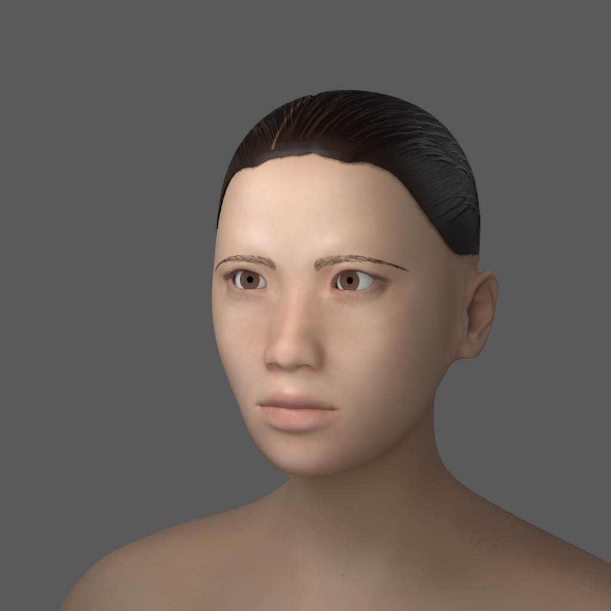
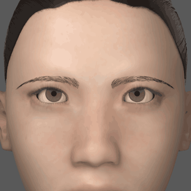
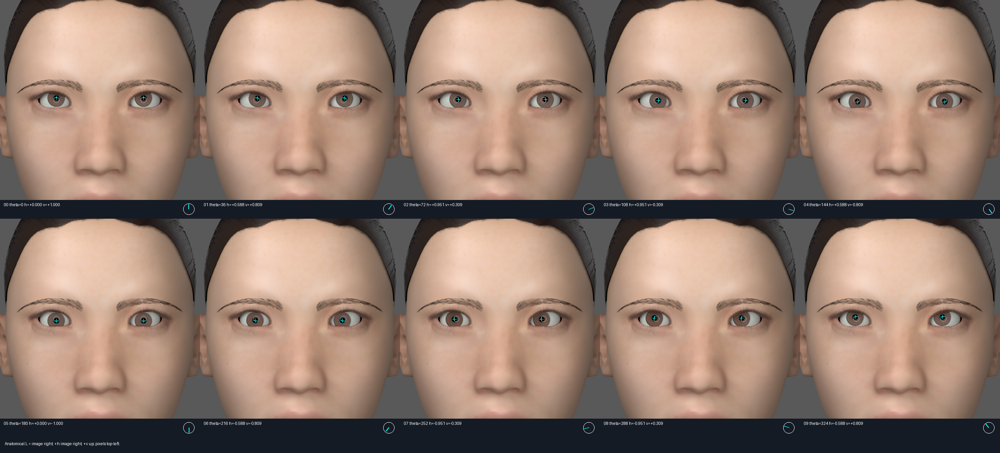
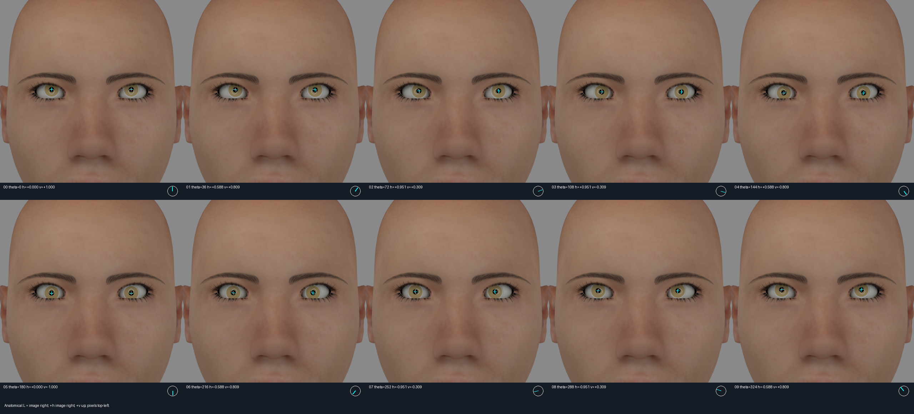
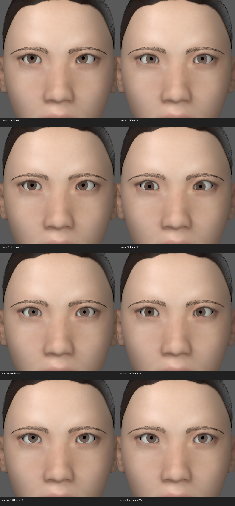
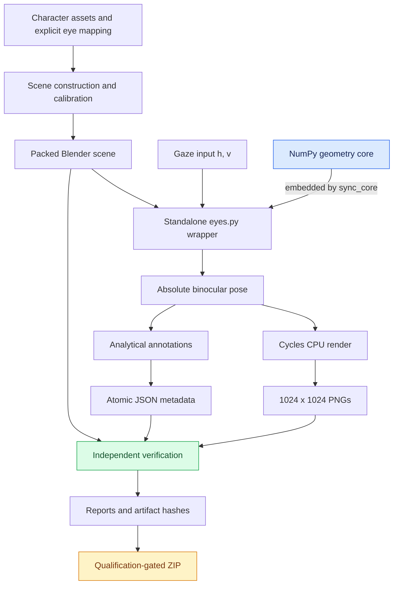
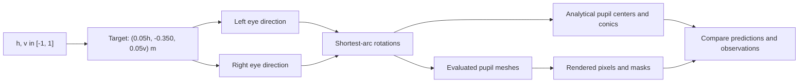
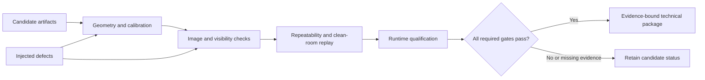

**Built for the Samsung R&D XR Team by AICA**

# Apollo
### Synthetic binocular gaze. Analytical labels. Independently checked pixels.

Apollo turns a calibrated 3D character into reproducible eye images and gaze annotations for **Samsung PRISM-XR Track 01**. Give it a fixation target: both eyes converge, Blender renders the pose, and independent checks compare the intended geometry with the actual image.

**The central contribution: closing the loop from gaze command to rendered evidence.** Apollo combines binocular control, exact projected pupil geometry, pixel measurements, deliberate fault injection, and reproducible delivery in one pipeline.

<p align="center">
  
</p>

<p align="center"><em>Actual Blender output from the CPU appearance candidate. Inspection portrait uses a separate camera; benchmark images use the calibrated camera.</em></p>

| At a glance | Recorded evidence |
| --- | --- |
| Qualified competition build | All 17 verification gates pass on Windows and Linux |
| Independent geometry audit | 1,009 poses · 14 injected faults detected |
| Latest appearance stress suite | 113/113 poses · 256/256 corpus images pass |
| Delivery | Packed Blender scene · standalone wrapper · PNGs + JSON |

[Run Apollo](#quick-start) · [Results](#results-and-benchmarks) · [Team setup](TEAM_SETUP.md) · [Technical delivery](delivery/apollo/README.md)

## Index

1. [Why Apollo](#why-apollo)
2. [Output gallery](#output-gallery)
3. [Architecture](#architecture)
4. [How gaze becomes ground truth](#how-gaze-becomes-ground-truth)
5. [Results and benchmarks](#results-and-benchmarks)
6. [Quick start](#quick-start)
7. [API and output contract](#api-and-output-contract)
8. [Reproducibility and release status](#reproducibility-and-release-status)
9. [Limits and next steps](#limits-and-next-steps)
10. [Explore the repository](#explore-the-repository)

## Why Apollo

Synthetic eye images are useful only when their labels describe what was actually rendered. A correct rotation formula alone cannot catch a displaced mesh, hidden pupil, stale output, or broken light. Apollo checks these failure modes across the full pipeline.

| Core contribution | What Apollo implements | Why it matters |
| --- | --- | --- |
| **Shared-target binocular control** | Absolute shortest-arc eye rotations toward one 3D fixation point | Preserves vergence and avoids accumulating incremental rotation errors |
| **Analytical pupil annotations** | Calibrated pinhole projection and exact projected-circle conics | Supplies pupil centers and ellipse annotations directly from geometry |
| **Independent verification** | Separate Rodrigues/projection reference, evaluated mesh measurements, blind detectors, templates and real occlusion masks | Checks agreement between mathematics, deformed geometry and pixels |
| **Tests that must catch defects** | Geometry mutations, rendered half-pupil obstruction and lighting-loss adversaries | Demonstrates that checks reject tested failures, beyond passing clean inputs |
| **Reproducible artifacts** | Fixed seeds, atomic metadata, hash-bound reports, archive replay and resumable corpus generation | Makes evidence traceable to the exact scene and outputs |
| **Appearance with protected geometry** | Packed character assets, fitted lids/lashes, skin and baked groom; protected eye-vertex checks | Allows visual iteration while retaining calibrated eye geometry |

These are Apollo's integrated engineering contributions, not claims that quaternion rotation, synthetic eyes, or conic projection are new inventions. The [component reconnaissance](docs/Synthetic%20Gaze%20Reconnaissance%20Plan.docx) and [literature review](docs/Synthetic%20Gaze%20Literature%20Discovery.docx) informed the design. The implemented stack uses Blender, MakeHuman/MPFB assets and Apollo's NumPy geometry core; see [asset attribution](assets/ATTRIBUTION.md).

## Output gallery

### Gaze in motion



*Animated gaze preview. Playback timing is illustrative and does not represent render throughput; use the benchmark table for measured timing.*

### Calibrated ten-frame output



*Actual CPU appearance candidate sweep. The protocol starts at the top and moves clockwise; image and annotation checks accompany the native frames.*

<details>
<summary><strong>Inspect the qualified baseline and stress-test evidence</strong></summary>



*Protected competition build: the scene to which the full Windows/Linux release qualification applies.*



*Selected stress cases from the newer appearance evaluation. [Review scope and results](milestones/appearance-stress-2026-11-10/README.md).*

</details>

## Architecture



The [pure NumPy core](apollo_core/core.py) owns the math. [The wrapper](wrapper/eyes.py) embeds it for standalone delivery, applies poses inside Blender, and checks evaluated projection before accepting records. [The verifier](tools/verify.py) coordinates artifact, image, geometry, runtime and replay checks. MPFB is needed for relevant character-building workflows, not for rendering the packed delivery.

## How gaze becomes ground truth



The target plane sits 35 cm in front of the eye midpoint; the camera sits 40 cm in front. Each eye points from its own center to the same target. `reset()` returns to centered fixation, including convergence.

The ten-frame protocol uses `theta = 2*pi*k/10`, `h = sin(theta)`, `v = cos(theta)`. Separate research protocols sample the wider input domain rather than treating ten sweep frames as exhaustive coverage.



## Results and benchmarks

**These are measured local engineering results, not official competition scores or downstream gaze-estimation accuracy.** Each column below belongs to a different frozen scene and evaluation scope.

### Correctness and coverage

| Measurement | Qualified competition build · 7 Nov | CPU appearance candidate · latest evidence through 10 Nov |
| --- | --- | --- |
| Full release verification | Windows/Linux V1–V17 pass; applicable secondary-runtime checks pass | Full cross-platform release qualification outstanding |
| Independent geometry audit | 1,009 poses; 14/14 faults detected | 1,009 poses; 14/14 faults detected |
| Ten-frame sweep, maximum blind pupil error | 0.175464 px | 0.108 px, rounded upward |
| Separate seeded corpus | 256/256 images pass | 256/256 images pass |
| Corpus maximum geometry-guided pixel error | 0.217847 px | 0.153842 px, rounded upward |
| Actual-mask visibility coverage | 25 poses | 113/113 stress poses pass |
| Maximum mask-centroid residual | 0.030619 px | 0.044821 px, rounded upward |
| Minimum visible dark pupil fraction | 1.0 | 0.9982608696 |
| Rendered half-pupil obstruction | Detected | Detected; measured fraction 0.499356 |
| Reset reproduction | Byte-identical center image | Byte-identical corner-to-reset center image |
| Recorded Python test suite | 79 passing on Windows and Linux | 82 passing in workspace after checkpoint retry fix |

Sources: [competition verification](milestones/competition-upgrade-2026-11-07/verification_report.md), [upgrade evidence and corpus analysis](docs/UPGRADE_PROGRESS.md), [appearance candidate checks](milestones/photorealism-v2-candidate/README.md), and [113-pose / 256-image stress evaluation](milestones/appearance-stress-2026-11-10/README.md). The 82-test result covers the later checkpoint fix; the stress images were rendered using the frozen source recorded in that evaluation.

The latest appearance stress suite also records maximum blind/template pupil errors of **0.277359 / 0.137939 px** across its stress/corpus checks (rounded upward). Different detectors measure different quantities; these residuals are not interchangeable with mask-centroid or conic-center errors. See [verification methods and limits](docs/VERIFIER_COVERAGE.md).

### CPU rendering cost

| Scene / experiment | Samples | Pose scope | Measured frame time |
| --- | ---: | --- | ---: |
| Earlier radial development baseline | 32 | Ten-frame sweep | 23.653 s mean |
| Earlier radial sample experiment | 16 | Center / up / down | 12.896 s mean |
| Earlier radial sample experiment | 8 | Center / up / down | 5.094 s mean |
| Final CPU appearance candidate | 32 | Center | 54.59 s |
| Final CPU appearance candidate | 32 | Up | 58.03 s |
| Final CPU appearance candidate | 32 | Corner | 72.55 s |

Recorded on the project's Intel Core i5-1135G7 laptop using Cycles CPU at 1024×1024. The earlier sample experiment used fixed seeds and no denoising. Pose sets and scene complexity differ: this is not a controlled speedup comparison. Lower sample settings are iteration experiments, not replacements for qualified settings. Sources: [baseline timing methodology](docs/PERFORMANCE.md) and [appearance benchmark](milestones/photorealism-v2-candidate/evidence/performance/benchmark.json).

The final appearance candidate contains **464,088 visible evaluated polygons**, with **1.40 GiB peak measured process RSS** across the measured stages. Its full stress automation took **8.02 hours**, including monitoring gaps and recovery; that duration is not a pure rendering benchmark.

## Quick start

### Replay the qualified packed scene

Install Blender compatible with the recorded release runtime (primary: **4.5.15 LTS**). From the repository root, with `blender` on `PATH`:

```powershell
blender -b delivery/apollo/scene.blend --python-exit-code 1 -P delivery/apollo/wrapper/eyes.py -- --out out/replay
```

This writes ten PNGs and `metadata.json` into a separate replay directory. The packed scene needs no MPFB add-on. Omit quality overrides to retain its stored render settings.

Render one pose:

```powershell
blender -b delivery/apollo/scene.blend --python-exit-code 1 -P delivery/apollo/wrapper/eyes.py -- --h 1 --v 0 --out out/right.png
```

### Set up development

```powershell
python -m venv .venv
.\.venv\Scripts\Activate.ps1
python -m pip install -r requirements.txt
$env:BLENDER_BIN = 'C:\Program Files\Blender Foundation\Blender 4.5\blender.exe'
python tasks.py test
python tasks.py doctor
```

Use Python 3.10+ and the pinned dependencies. Set `BLENDER_SECONDARY_BIN` for secondary-runtime qualification. Follow [TEAM_SETUP.md](TEAM_SETUP.md) for assets and teammate setup, [RUNBOOK.md](docs/RUNBOOK.md) for individual pipeline stages, and [UPGRADE_RUNBOOK.md](docs/UPGRADE_RUNBOOK.md) to reproduce the competition look. The original development builder produces the earlier radial appearance; it does not reproduce the latest appearance candidate automatically.

## API and output contract

Inside Blender Python, import the standalone `wrapper/eyes.py` module as `eyes`:

```python
eyes.move(0.5, 0.25)       # Absolute pose; finite inputs clamp to [-1, 1].
eyes.render('out/pose.png')
eyes.reset()               # Centered binocular fixation.
eyes.sweep(out_dir='out/sweep')
```

| Interface / artifact | Contract |
| --- | --- |
| `move(h, v)`, `reset()` | Absolute gaze control; centered reset |
| `render(path)`, `sweep(...)` | Single still or default ten-frame protocol |
| `state()`, `calibration()` | Current state and camera/scene calibration |
| `renders/frame_00.png` … `frame_09.png` | Ten 1024×1024 rendered images |
| `metadata.json` | Frame index, sweep angle, input, left/right eye rotations, projected pupil centers, intrinsics and extra annotations |
| Verification reports | Results tied to scene, wrapper, metadata and image hashes |

World units are meters; the subject faces −Y and +Z is up. Anatomical left appears on image right. Positive `h` is image right; positive `v` is image up. Pixels use a top-left origin. Eye rotations are world-relative XYZ Euler angles in radians. `camera_matrix` is the 3×3 intrinsic matrix.

Metadata is replaced atomically only after a complete successful sweep; regeneration invalidates the previous manifest first. See [the metadata schema](metadata.schema.json) and [semantic validation](apollo_core/metadata.py).

## Reproducibility and release status

| Artifact | Role | Where to start |
| --- | --- | --- |
| Protected competition build | Full qualified technical reference | [Release evidence](milestones/competition-upgrade-2026-11-07/README.md) · [Executable layout](delivery/apollo/README.md) |
| CPU appearance candidate | Refined skin, hair, brows and lashes; targeted checks and native stress evidence | [Candidate handoff](milestones/photorealism-v2-candidate/README.md) · [Stress report](milestones/appearance-stress-2026-11-10/README.md) |
| Earlier development freeze | Historical radial-iris reference | [Freeze evidence](milestones/dev-freeze-2026-11-07/README.md) |

The competition archive regenerated all ten sweep PNGs and metadata byte for byte from an extracted layout and different working directory. Interrupted 255→256 corpus resume reproduced the completed dataset. Determinism claims apply to the tested runtime/machine; cross-version correctness is checked separately with tolerances. Identical image output does not imply identical binary `.blend` saves.

The newer appearance candidate is integrated into `main`, but its native stress results do not promote it to a fully qualified cross-platform release. Release names and promotion rules are documented in [RELEASES.md](docs/RELEASES.md). Organizer upload and submission remain team-owned.

## Limits and next steps

Apollo currently generates synthetic gaze data; it does not establish headset tracking accuracy or trained gaze-estimator performance. The scene uses a fixed identity and controlled lighting, fixed pupils, and simplified non-refractive eyes. Native 2K skin and efficient baked hair retain visible CG limitations. Finite test coverage does not establish universal detector robustness or human-rated naturalness.

Next evidence gaps are full cross-platform qualification of the appearance candidate, independent teammate/human review, and downstream evaluation if the generated data is used to train an estimator. See [the roadmap](docs/ROADMAP.md) and [phase handoff](docs/PHASE_HANDOFF.md).

## Explore the repository

| Area | Entry point |
| --- | --- |
| Teammate onboarding | [TEAM_SETUP.md](TEAM_SETUP.md) |
| Source navigation | [FILEMAP.md](FILEMAP.md) |
| Requirements and rubric | [Problem statement](docs/problem_statement.md) |
| Geometry and design | [Technical solution](docs/SOLUTION_TECHNICAL.md) · [Core implementation](apollo_core/core.py) |
| Standalone Blender interface | [wrapper/eyes.py](wrapper/eyes.py) |
| Verification and fault coverage | [Verifier coverage](docs/VERIFIER_COVERAGE.md) |
| Appearance construction and measurements | [Photorealism execution record](docs/PHOTOREALISM_V2.md) |
| Character and texture provenance | [Character attribution](assets/ATTRIBUTION.md) · [Appearance asset attribution](assets/photorealism-v2/ATTRIBUTION.md) |

---

**Apollo · AICA · Samsung PRISM-XR Track 01**
