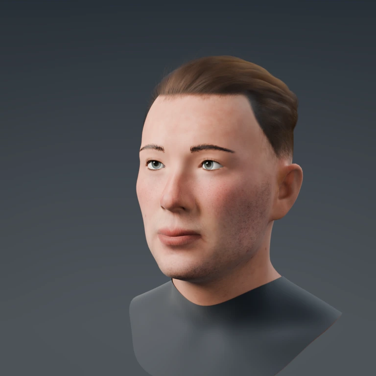
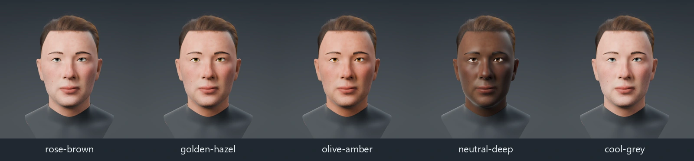
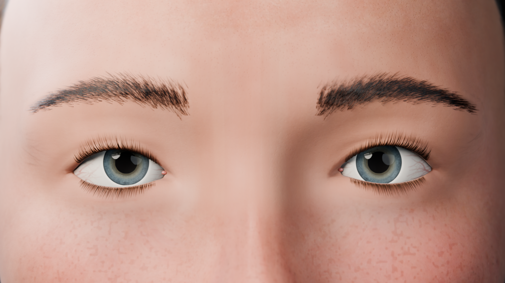
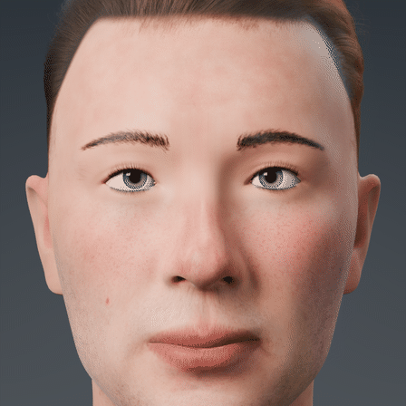
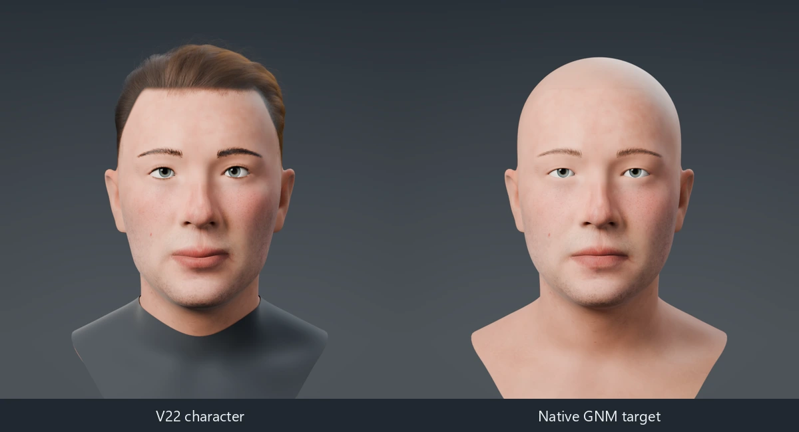
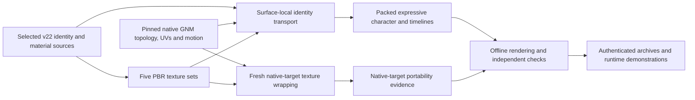

# Apollo
### Computational gaze synthesis for expressive virtual humans

**Developed by AICA for Samsung PRISM-XR · Track 01**

## Submission deliverables

| Deliverable | Open or download |
| --- | --- |
| **Two-minute product showcase** | [Watch on Google Drive](https://drive.google.com/file/d/1VvcGvrvvZkVslSPpuijQcmTFgwsYwgF_/view?usp=sharing) · [Repository copy](VITVellore_AICA_Demo.mp4) |
| **Official presentation** | [VITVellore_AICA.pptx](VITVellore_AICA.pptx) |
| **AI disclosure form** | [AI disclosure form](AI_Disclosure.docx) |
| **Executable product** | [Download the product ZIP — 1.32 GB](https://github.com/Eldo-John-Giby/Apollo/releases/download/apollo-v0.3.0/VITVellore_AICA_Product.zip) |
| **Three runtime demonstrations** | [Left](videos/left.mp4) · [Right](videos/right.mp4) · [Generate Motion](videos/generate_motion.mp4) |

The presentation, demo video and disclosure form sit at the repository root.
Download the **single product ZIP**, extract it, and follow the included README.
It retains all five full-resolution texture variants, three executable motion modes
and the three twelve-second preview clips. No split-file reassembly is needed.
The original full evidence archive and extended scene supplement remain optional
on the [release page](https://github.com/Eldo-John-Giby/Apollo/releases/tag/apollo-v0.3.0).
[Package setup](docs/V22_QUICKSTART.md) · [Submission requirements](docs/PS_AUDIT.md)

[](https://github.com/Eldo-John-Giby/Apollo/releases/tag/apollo-v0.3.0)
[](docs/V22_QUICKSTART.md)
[](milestones/v22-12-second-demonstrations-2026-11-22/qualification/final-qualification-summary.json)

**Five material variants · Three motion modes · Reproducible execution**

 

*Actual v22 Blender renders. The animation retains the twelve-second sequence, sampled at 12 fps for this page; release videos run at 24 fps.*

[**Download v0.3.0**](https://github.com/Eldo-John-Giby/Apollo/releases/tag/apollo-v0.3.0) · [**Run Apollo**](#reproduce-the-results) · [**Inspect the evidence**](#verification-and-reproducibility)

## Contents

| Section | Overview & Key Deliverables | Jump |
| :--- | :--- | :--- |
| **1. Overview** | Synthetic gaze synthesis, v22 character identity and GNM motion integration | [Jump to section](#overview) |
| **2. Submission at a glance** | 60/20/20 rubric alignment: 5 variants, 3 motion modes, 24 fps runtime demos | [Jump to section](#submission-at-a-glance) |
| **3. Appearance and material diversity** | 5 photorealistic palettes, 4K PBR skin, dual irises, judging stills | [Jump to section](#appearance-and-material-diversity) |
| **4. Motion and expression** | Left, Right, Generate Motion, eyelid follow, brow dynamics, asymmetric blinks | [Jump to section](#motion-and-expression) |
| **5. Native-target portability** | Pinned GNM Head v3 with tested `udim` and `legacy` layouts | [Jump to section](#native-target-portability) |
| **6. Verification and reproducibility** | Clean Windows & Linux runtime qualification, scoped image comparison, 175 passing source tests per platform | [Jump to section](#verification-and-reproducibility) |
| **7. Reproduce the results** | Step-by-step judge runbook: Single ZIP download and CLI rendering commands | [Jump to section](#reproduce-the-results) |
| **8. Research foundations** | Analytical 3D spherical rotation, Rodrigues formula, conic pupil projection | [Jump to section](#research-foundations) |
| **9. Scope, provenance and attribution** | CC0 & open asset licenses, model provenance, and attribution records | [Jump to section](#scope-provenance-and-attribution) |
| **10. Repository guide** | Direct index of quickstarts, runbooks, core math, and tool entry points | [Jump to section](#repository-guide) |

## Overview

Apollo integrates detailed facial appearance, coordinated ocular motion and reproducible rendering into a deployable synthetic gaze pipeline. The current release combines the selected **v22 facial identity and groom** with native Google GNM Head v3 motion, five physically based material variants and automated Blender execution.

The central engineering problem is preserving a recognizable facial identity while transferring expression and gaze without corrupting the target topology, UV coordinates or native eye geometry. Apollo addresses this through surface-local identity transport, deformation-aware attachments and independent verification of saved scenes and rendered outputs.

The result is an inspectable submission: textured heads, executable motion, runtime demonstrations and provenance that connects each deliverable to its source inputs. The earlier calibrated gaze and analytical annotation system remains available as a separate research baseline.

## Submission at a glance

| Deliverable | v0.3.0 implementation |
| --- | --- |
| Face and eye texture sets | **5 complete variants**, with 4096 × 4096 skin maps and 2048 × 2048 maps for each eye |
| Material representation | Base color, roughness, specular and tangent-space normal data, with explicit color-space and binding metadata |
| Input modes | **Left**, **Right** and **Generate Motion**, using the viewer's screen convention |
| Runtime demonstrations | **3 twelve-second H.264 clips**, 1024 × 1024 at 24 fps; 288 frames per mode |
| Base technical sequences | **576 PNGs** across three packed, 192-frame timelines at 24 fps |
| Rendering | Cycles, **512 samples** for motion; authenticated higher-sample judging stills supplied separately |
| Portability | Pinned GNM Head v3; native topology and both `udim` and `legacy` UV layouts retained |
| Execution | Python launcher, packed Blender scenes, offline operation and verified frame recovery |

The base archive preserves the original eight-second reproduction contract. The separate supplement extends each mode to twelve seconds with new timeline keys, additional gaze transitions and blink events. Its first 192 frames reuse the authenticated base sequence; the extension is not a slowed or looped copy of the original clip.

The submission follows the published evaluation structure:

| Evaluation criterion | Evidence to inspect |
| --- | --- |
| Texture photorealism · 60 points | [Five material variants and ocular detail](#appearance-and-material-diversity) |
| Kinematic accuracy · 20 points | [Coordinated motion, eyelid closure and pose verification](#motion-and-expression) |
| Code and UV portability · 20 points | [Fresh native wrapping](#native-target-portability) and [reproducible execution](#reproduce-the-results) |

## Appearance and material diversity



*Five authenticated judging renders of the integrated character, displayed under matched frontal framing.*

The appearance pipeline combines spatial skin variation, fine surface relief, distinct left/right iris maps, layered ocular shading, fitted lashes and the selected hair groom. Material data are separated from their Blender bindings so that texture application can be evaluated independently of the full character presentation.

`rose-brown` is the selected default palette, with blue-grey eyes. The remaining variants are `golden-hazel`, `olive-amber`, `neutral-deep` and `cool-grey`. Base color is interpreted as sRGB; scalar surface properties and tangent-space normals use Non-Color data. Binding follows the current PBR manifests.

<p></p>

*Fresh 1920 × 1080 Blender render of the selected v22 character, with both brows and eyes in frame. Full-resolution image available by opening the image. Camera and lighting are derived; character geometry and materials are unchanged.*

## Motion and expression

| Left | Right | Generate Motion |
| :--- | :--- | :--- |
|  |  |  |
| [Full-quality clip](videos/left.mp4) | [Full-quality clip](videos/right.mp4) | [Full-quality clip](videos/generate_motion.mp4) |

The native GNM trajectories provide the expression and ocular reference. Apollo transports the selected facial offsets with local surface rotations while keeping protected eye components identical to their native poses. Hair, brows, lashes and tear-region attachments follow the deforming surface through recorded anchors and local orientations.

For vertex *i*, the appearance layer takes the form

$$\mathbf{x}^{\mathrm{Apollo}}_i(t)=\mathbf{x}^{\mathrm{GNM}}_i(t)+\mathbf{R}_i(t)\,\Delta\mathbf{x}_i.$$

Here, $\Delta\mathbf{x}_i$ is the selected identity offset and $\mathbf{R}_i(t)$ is the best-fit rotation of its native one-ring neighborhood, estimated by singular value decomposition. Offsets preserve their physical magnitude rather than stretching with eyelid motion; protected native eye components receive zero identity offset. The implementation and its invariants are explicit in [identity transport](apollo_core/identity.py) and [timeline integration](tools/gnm_v22_integrate.py).

Saved base timelines were checked at **383 integer and half-frame sample times per mode**, with separate checks covering eighteen appearance components. The twelve-second extensions include fresh-process scene comparisons and image-based gaze/blink checks. [Extension methodology and receipts](docs/V22_12_SECOND_DEMOS.md)

## Native-target portability



*Left: full v22 identity and groom. Right: texture-only application to the unchanged native target. These are distinct evaluation outputs.*

Apollo preserves the native vertex order, topology and UV layouts. A separate texture-only pathway demonstrates fresh wrapping on the pinned target without substituting the sculpted character for the evaluator mesh. The five-set native matrix covers **30 cases: five variants × two layouts × three views/lighting conditions**.



## Verification and reproducibility

Evidence is tied to the exact scenes, maps, source files and images through SHA-256 manifests. Numerical checks, saved-scene inspection and image diagnostics serve complementary roles: a valid file does not establish correct motion, and an attractive render does not establish portability.

| Evaluation layer | Recorded result and scope |
| --- | --- |
| Source tests | **175 passing tests per platform** in retained Windows/Linux test records; unchanged-source reuse is authenticated |
| Base archive integrity | **831 payload files verified** after clean extraction; ZIP CRC and archive SHA-256 checked |
| Supplement integrity | **329 payloads verified**, including extended scenes, added frames, videos and receipts |
| Clean runtime | Exact submission archive exercised on **Windows and Linux**, offline, outside the repository and in paths containing spaces |
| Recovery and rejection | Verified-frame preservation, missing/corrupt-frame repair, stale-receipt rejection and invalid-range rejection recorded |
| Image comparison | Three held neutral frames compared across platforms: maximum channel difference **5/255**, mean **0.0096/255**; outputs are not byte-identical across platforms |
| Delivery hygiene | Packaged text and payload hygiene checks passed for the recorded archives |

The cross-platform image comparison is limited to three held neutral frames. The source-test counts refer to the authenticated test snapshot included with the release.

**Evidence:** [final qualification summary](milestones/v22-12-second-demonstrations-2026-11-22/qualification/final-qualification-summary.json) · [Windows report](milestones/v22-12-second-demonstrations-2026-11-22/qualification/windows-qualification.json) · [Linux report](milestones/v22-12-second-demonstrations-2026-11-22/qualification/linux-qualification.json) · [demonstration inventory](milestones/v22-12-second-demonstrations-2026-11-22/delivery.json) · [release checksums](milestones/stable-v0.3.0/release-assets.json)

## Reproduce the results

### 1. Obtain the release

Download [the single product ZIP](https://github.com/Eldo-John-Giby/Apollo/releases/download/apollo-v0.3.0/VITVellore_AICA_Product.zip) and extract it into a fresh directory. No reassembly is required. The source-code download is a development checkout; runtime commands below expect the extracted package's `model/`, `textures/` and `timelines/` directories. Keep the extracted folder intact so relative image paths resolve.

Extract `apollo-v22-12-second-demonstrations.zip` separately for the ready-to-play clips and extended, packed timelines. Open a supplement `timelines/<mode>/expression.blend` and play frames **1–288 at 24 fps**. The base timelines use frames **1–192**.

### 2. Verify and render

Use **Python 3.10+** and **Blender 4.5.15 LTS**, build `5afeabba6097`. The launcher uses Python's standard library; Blender supplies its numerical runtime. Runtime playback does not require MCP, MPFB or a separate GNM installation.

From the freshly extracted base runtime on Windows:

```powershell
python tools/gnm_bundle_verify.py --reject-extra
$blenderPath = 'C:/Program Files/Blender Foundation/Blender 4.5/blender.exe'
python tools/gnm_run.py still --blender $blenderPath --out renders/hero.png
python tools/gnm_run.py left --blender $blenderPath --out renders/left --first 1 --last 3
python tools/gnm_run.py right --blender $blenderPath --out renders/right --first 1 --last 3
python tools/gnm_run.py generate-motion --blender $blenderPath --out renders/motion --first 1 --last 3
```

On Linux, supply the absolute Blender executable path:

```bash
python3 tools/gnm_run.py generate-motion --blender /opt/blender/blender --out 'renders/motion with spaces' --first 1 --last 3
```

Remove `--first` and `--last` to render all 192 base frames. Choose materials and UVs with `--variant olive-amber --layout legacy`; both `udim` and `legacy` are supported. Keep separate output directories for each mode, variant and layout. Repeating the same command preserves verified frames and repairs missing or corrupt images. The launcher enables Blender offline mode.

The released motion preset uses 512 Cycles samples and is intended for offline synthesis. The included videos provide immediate inspection without a new render. [Full setup, variants and recovery behavior](docs/V22_QUICKSTART.md)

## Research foundations

Apollo also retains a calibrated binocular gaze engine for analytical annotation research. It solves per-eye fixation toward a shared 3D target, projects physical pupil centers and pupil-boundary conics through a calibrated camera, and checks geometry against rendered pixels. The fixed ten-pose protocol and seeded 256-image corpus have their own evidence and release boundaries.

These historical measurements are documented separately and are not transferred to the v22 pipeline. See the [mathematical model](docs/SOLUTION_TECHNICAL.md), [verification coverage](docs/VERIFIER_COVERAGE.md), [research workflow](docs/UPGRADE_RUNBOOK.md) and [protected competition baseline](milestones/competition-upgrade-2026-11-07/README.md).

## Scope, provenance and attribution

Independent human appearance/motion review remains outstanding. Compatibility is demonstrated on pinned public GNM Head v3 and its tested layouts; an undisclosed organizer evaluator asset has not been tested. Internal measurements are engineering evidence, rather than an organizer score. The [release notes](docs/RELEASES.md) document the exact qualification scope.

The implementation builds on attributed external model, skin and eye resources. Licenses, source records and attribution accompany the technical package. The iris reconstruction uses a photographic source region of approximately 440 pixels; a 2K output map is a delivery resolution rather than a claim of 2K captured detail. Preserve the original asset terms when redistributing.

[GNM source and license](assets/gnm/) · [Scan provenance](assets/gnm-scan/ATTRIBUTION.md) · [Eye-source provenance](assets/gnm-eye-photo/ATTRIBUTION.md) · [Selected-identity provenance](assets/v22-provenance.json) · [README media provenance](docs/images/apollo-v22-media-provenance.json)

## Repository guide

| Resource | Purpose |
| --- | --- |
| [v22 quickstart](docs/V22_QUICKSTART.md) | Current runtime setup, materials, playback and recovery |
| [Submission evidence](docs/V22_SUBMISSION.md) | Detailed technical history and evidence boundaries |
| [Release history](docs/RELEASES.md) | Stable release scope, archive hashes and retained baselines |
| [GNM integration](docs/GNM_INTEGRATION.md) | Native model preparation, construction and portability |
| [Core numerical methods](apollo_core/) | Identity transport, geometry, projection and protocol logic |
| [Build and verification tools](tools/) | Scene integration, texture binding, rendering, checks and packaging |
| [File map](FILEMAP.md) | Implementation navigation by responsibility |
| [Team setup](TEAM_SETUP.md) | Development environment and collaboration conventions |

---

**AICA · Apollo · Samsung PRISM-XR Track 01**
