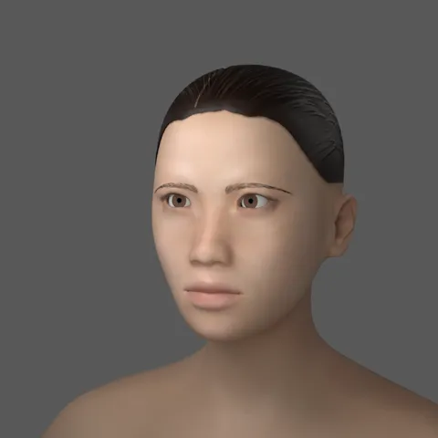
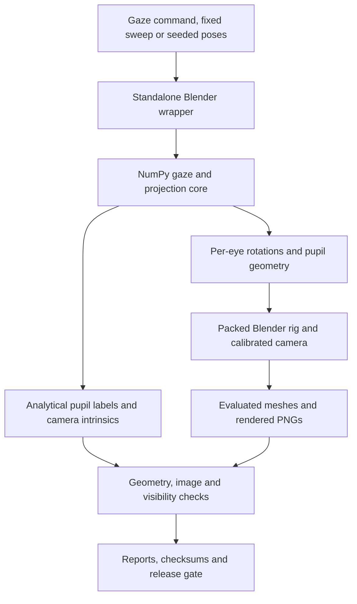
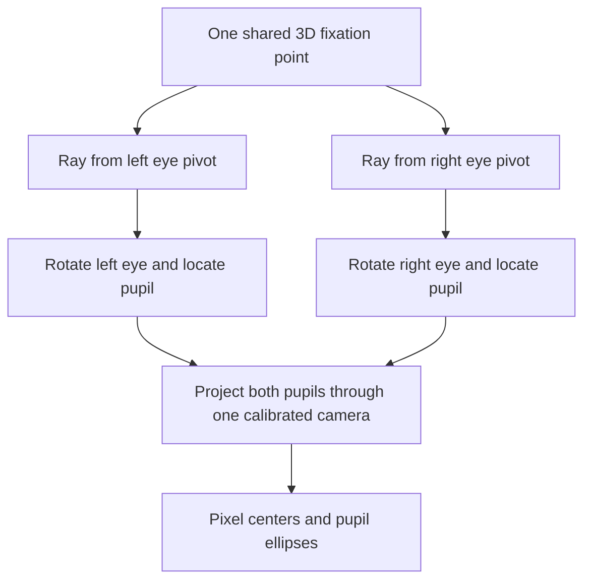
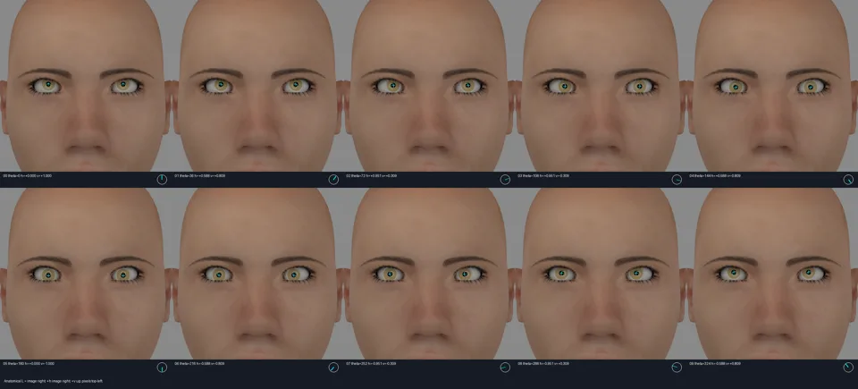

**Built for the Samsung R&D XR Team by AICA**

# Apollo

**v22 submission candidate:** five portable texture variants and three packed
192-frame gaze timelines derived from the approved v22 face and groom.
[v22 setup and first render](docs/V22_QUICKSTART.md) ·
[Requirements and current evidence](docs/V22_SUBMISSION.md).
The integrated identity is approved; independent visual review and final release
qualification remain pending. The earlier qualified pipelines below remain
available as separate baselines.

**Synthetic binocular gaze with pupil labels you can verify against the render.**

Samsung PRISM-XR · Track 01 · Synthetic Eye Movement & Virtual Camera Rendering

Apollo takes a gaze command, aims both eyes at a shared 3D target, and renders the result through a calibrated Blender camera. Each frame comes with analytical pupil coordinates and camera intrinsics. Separate checks measure the evaluated eye geometry and the rendered pixels, so a plausible-looking image alone cannot pass verification.

<p>
  
  
</p>

*Actual Blender outputs from the CPU appearance candidate. The portrait uses a separate review camera. The GIF loops the ten calibrated poses at display speed.* [Native sweep PNGs and metadata](milestones/photorealism-v2-candidate/README.md)

## Index

[Contributions](#contributions) · [Architecture](#architecture) · [Outputs](#outputs) · [Results and benchmarks](#results-and-benchmarks) · [Quick start](#quick-start) · [Repository guide](#repository-guide)

## Contributions

1. **One target, two independently solved eyes.** Apollo computes a gaze ray from each eye pivot to the same 3D point and applies a shortest-arc rotation. Absolute commands eliminate drift from incremental input. Reset restores centered binocular fixation. [Gaze solver](apollo_core/core.py)
2. **Analytical labels from the same calibrated scene that makes the image.** Apollo projects the physical pupil center and the circular pupil boundary into pixel space. The boundary becomes an exact perspective conic. The projection of the physical center and the center of the projected ellipse are recorded as distinct quantities. [Geometry and camera model](docs/SOLUTION_TECHNICAL.md)
3. **Independent measurements and deliberate failures.** An independent geometry oracle measures deformed meshes, and image checks measure rendered pupils. Injected faults test whether the suite detects bad geometry, half-pupil obstruction and lighting loss. The release gates tie measurements to the exact scene, wrapper and outputs by hash. [Verifier coverage](docs/VERIFIER_COVERAGE.md)
4. **Replayable delivery and separate research data.** The packed scene runs through a standalone Blender wrapper. The fixed ten-frame protocol and the seeded, resumable research corpus have separate manifests and verification paths. [Release evidence](milestones/competition-upgrade-2026-11-07/README.md) · [Dataset workflow](docs/UPGRADE_RUNBOOK.md)

The engineering contribution is the integration of binocular synthesis, calibrated rendering, analytical labels and independently checked evidence in one replayable pipeline. The character pipeline uses attributed MakeHuman/MPFB assets, with a dedicated Apollo eye rig. [Asset provenance](assets/ATTRIBUTION.md) · [Literature review](docs/Synthetic%20Gaze%20Literature%20Discovery.docx)

## Architecture



The wrapper embeds the NumPy core for standalone playback. The camera sits 40 cm in front of the eye midpoint, with the fixation plane 35 cm in front. Finite gaze inputs are clamped to ±1 and map to ±5 cm on the plane. Positive horizontal input moves image right, and positive vertical input moves image up. Pixel coordinates start at the top left. [Wrapper](wrapper/eyes.py) · [Metadata schema](metadata.schema.json)



## Outputs

[](milestones/competition-upgrade-2026-11-07/contact_sheet.png)

*Qualified competition build. Select the preview for the full annotated contact sheet.*

| Output | What to inspect |
| --- | --- |
| Official sweep | Ten 1024 × 1024 PNGs, clockwise from the top, and a matching JSON array with gaze inputs, eye rotations, pupil positions and camera intrinsics. [Executable delivery](delivery/apollo/README.md) |
| Research corpus | 256 seeded poses with a separate manifest and independent pixel analysis. [Corpus manifest](milestones/competition-upgrade-2026-11-07/dataset-256/dataset.json) |
| Appearance evidence | Packed adult character with fitted lids and tear tissue, brown iris atlas and baked hair. Includes native eye crops and matched comparisons. [Appearance candidate](milestones/photorealism-v2-candidate/README.md) |
| Replay archive | Packed scene, wrapper, renders, metadata and evidence for reproducing the qualified sweep. [Technical release](milestones/competition-upgrade-2026-11-07/README.md) |

## Results and benchmarks

The competition baseline passed full qualification. The later CPU appearance candidate has targeted checks and a separate native CPU stress evaluation. Each result belongs to its recorded scene and test set.

| Measurement | Qualified competition baseline | CPU appearance candidate |
| --- | --- | --- |
| Release qualification | V1–V17 pass on Windows and Linux with Blender 4.5.15, including applicable 5.2.3 checks | Cross-platform release qualification pending |
| Independent geometry audit | 1,009 poses checked, 14/14 injected faults detected | 1,009 poses checked, 14/14 injected faults detected |
| Ten-frame sweep, max blind pupil error | 0.175464 px | 0.108 px, rounded up |
| Seeded corpus, max independent pixel residual | 256/256 pass, 0.217847 px | 256/256 pass, 0.153842 px |
| Visibility masks, max centroid residual | 25 poses, 0.030619 px, full visible dark coverage | 113/113 stress poses pass, 0.044821 px, 99.826% minimum visible dark fraction |
| Rendered faults | Half-pupil obstruction and lighting loss detected | Half-pupil obstruction detected in stress evaluation |
| Reproduction | Extracted archive regenerated all ten PNGs and metadata byte for byte on the test host. Interrupted corpus resume matched completed output. | Fresh scene rebuild reproduced the center PNG byte for byte. Fresh reset matched center. |

[Competition reports and checksums](milestones/competition-upgrade-2026-11-07/README.md) · [Appearance validation](milestones/photorealism-v2-candidate/README.md) · [113-pose stress evaluation](milestones/appearance-stress-2026-11-10/README.md)

| Cycles CPU workload, 1024 × 1024 | Samples | Observed time |
| --- | ---: | --- |
| Earlier radial build, ten-frame sweep | 32 | 23.65 s/frame mean |
| Earlier radial build, center/up/down | 16 | 12.90 s/frame mean |
| Earlier radial build, center/up/down | 8 | 5.09 s/frame mean |
| CPU appearance candidate, single center/up/corner trials | 32 | 54.59 / 58.03 / 72.55 s |

The radial measurements used an Intel Core i5-1135G7 on Windows. The workloads differ, and lower sample counts showed more grain. These are local offline timings and engineering checks. Human naturalness, headset tracking accuracy and official competition scoring were outside the evaluation. [Performance notes](docs/PERFORMANCE.md) · [Appearance benchmark](milestones/photorealism-v2-candidate/README.md)

## Quick start

Use Blender 4.5.15 LTS. From the repository root, replay the qualified sweep into a fresh output directory. The packed scene includes the assets needed for playback.

```powershell
blender -b delivery/apollo/scene.blend --python-exit-code 1 -P delivery/apollo/wrapper/eyes.py -- --out out/replay
```

Render one pose by passing both gaze coordinates.

```powershell
blender -b delivery/apollo/scene.blend --python-exit-code 1 -P delivery/apollo/wrapper/eyes.py -- --h 1 --v 0 --out out/right.png
```

Inside Blender Python, the wrapper exposes `move(h, v)`, `reset()`, `render(path)`, `sweep()`, `state()` and `calibration()`. For development setup, tests, character mapping and rebuilding, see [Team setup](TEAM_SETUP.md) and the [Runbook](docs/RUNBOOK.md).

## Repository guide

| Start here | Purpose |
| --- | --- |
| [tasks.py](tasks.py) | Build, render, validate, verify and package from the CLI |
| [apollo_core/](apollo_core/) · [wrapper/](wrapper/) | Reference math and standalone Blender API |
| [build/](build/) · [tools/](tools/) | Scene construction, research corpus and verification |
| [FILEMAP.md](FILEMAP.md) | Find implementation and evidence by responsibility |
| [Release history](docs/RELEASES.md) | Qualified competition baseline, realism preview and development checkpoints |
